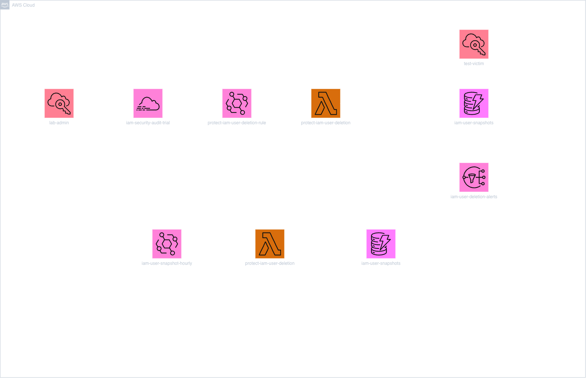

# Architecture

The project uses two EventBridge triggers and one preventive IAM policy.

## Hourly Snapshot

**EventBridge schedule → Lambda → IAM → DynamoDB**

Every hour, EventBridge invokes Lambda. The function reads IAM user configurations and saves them in the `iam-user-snapshots` DynamoDB table.

## IAM Deletion Response

**IAM `DeleteUser` → CloudTrail → EventBridge → Lambda → DynamoDB / IAM / SNS**

When an IAM user deletes another user, CloudTrail records the API operation. EventBridge matches the `DeleteUser` event and invokes Lambda.

Lambda checks DynamoDB for the deleted user's saved configuration, attempts to restore the user, adds the quarantine policy to the actor, and sends an SNS notification.

## Prevention

**IAM user request → IAM deny policy**

The `deny-deleting-other-iam-users` policy blocks selected deletion and access-removal operations for users in the group where the policy is attached. This prevents the covered actions instead of waiting for Lambda to respond afterward.

[The preventive IAM policy](../architecture/policies/deny-deleting-other-iam-users.json)
