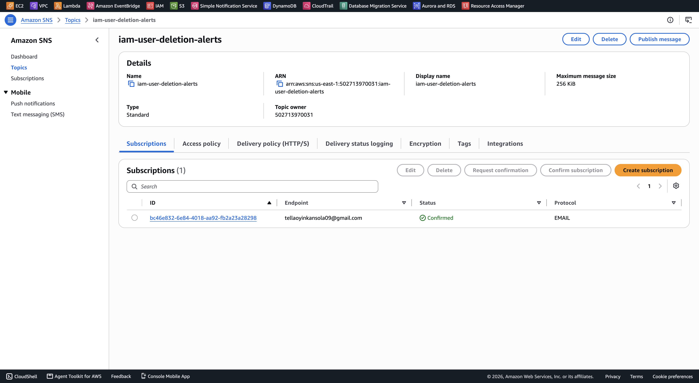
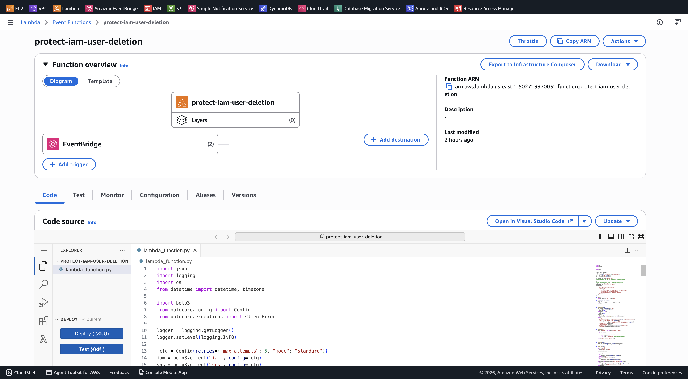
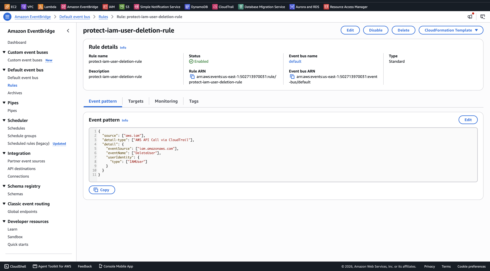
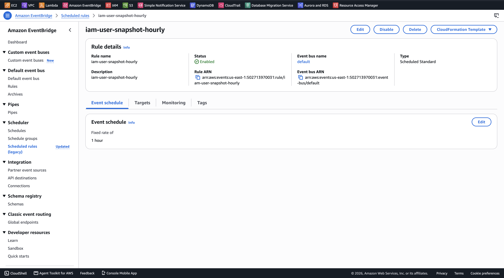

# Implementation

## CloudTrail and Amazon S3

AWS CloudTrail was configured to record IAM API activity, including the `DeleteUser` operation. A multi-Region trail was created with management write events and global service events enabled.

CloudTrail stores the recorded activity in an Amazon S3 bucket. These events are also used by EventBridge to detect IAM user deletion activity and invoke Lambda.

## Amazon SNS and DynamoDB

An SNS topic, `iam-user-deletion-alerts`, was created to send email notifications when Lambda processes an IAM deletion event. An email subscription was added and confirmed before testing.

DynamoDB stores IAM user configurations in the `iam-user-snapshots` table. Lambda saves user configurations periodically and retrieves them when attempting to recreate a deleted IAM user.

*Confirmed SNS email subscription.*

## AWS Lambda

The `protect-iam-user-deletion` Lambda function was created using Python and assigned a dedicated IAM execution role with permissions to access IAM, DynamoDB, and SNS.

The function handles IAM user snapshots, deletion events, restoration, quarantine, and notifications.

### Environment Variables

The following environment variables were configured:

| Variable | Value | Purpose |
|---|---|---|
| `SNS_TOPIC_ARN` | SNS topic ARN | Identifies the SNS topic used for email notifications. |
| `TABLE_NAME` | `iam-user-snapshots` | Identifies the DynamoDB table containing IAM user snapshots. |
| `ALLOWED_DELETERS` | Empty | Optional IAM usernames excluded from the automated response. |
| `DRY_RUN` | `false` | Enables restoration and quarantine attempts when a deletion event is processed. |

Setting `DRY_RUN=true` allows the function to send alerts without attempting restoration or quarantine. This option is useful when testing the event flow.

The Lambda timeout was set to two minutes, and the handler was configured as `lambda_function.handler`.

*Lambda function configured for IAM snapshots and deletion response.*

[Lambda source code](../lambda/lambda_function.py) | [IAM execution policy](../architecture/policies/lambda-execution-policy.json)

## Amazon EventBridge

Two EventBridge rules were configured to automate the Lambda function.

### IAM User Deletion Rule

The `protect-iam-user-deletion-rule` was created on the default EventBridge event bus.

It listens for `DeleteUser` API events recorded through CloudTrail and invokes Lambda when the deletion is performed by an IAM user.

*EventBridge rule configured to detect IAM user deletion activity.*

### Hourly Snapshot Rule

The second rule, `iam-user-snapshot-hourly`, uses the schedule expression `rate(1 hour)`.

It invokes Lambda every hour to collect IAM user configurations and update the snapshots stored in DynamoDB.

*EventBridge trigger configured for hourly IAM user snapshots.*

## Preventive IAM Policy

A managed IAM policy named `deny-deleting-other-iam-users` was created to restrict selected destructive IAM operations for users belonging to a protected group.

The policy uses explicit deny rules to prevent covered users from deleting other IAM users or removing certain access configurations, even when they have an Allow permission such as `IAMFullAccess`.

This adds prevention alongside the automated detection, recovery, and quarantine process.

[View preventive IAM policy](../architecture/policies/deny-deleting-other-iam-users.json)

## Lambda Test Events

Two test events were used to validate the Lambda function:

- **Snapshot test:** `{"action": "snapshot"}` — manually invokes the IAM snapshot process and saves user configurations to DynamoDB.
- **DeleteUser test:** Simulates an IAM deletion event initiated by `lab-admin` against `test-victim`.

[View DeleteUser test event](../lambda/testing.json)

Test execution and results are documented in [Testing](testing.md).
