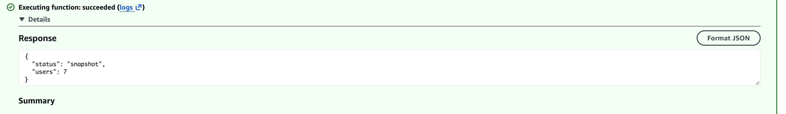
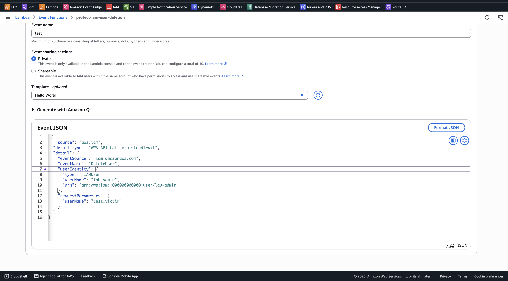
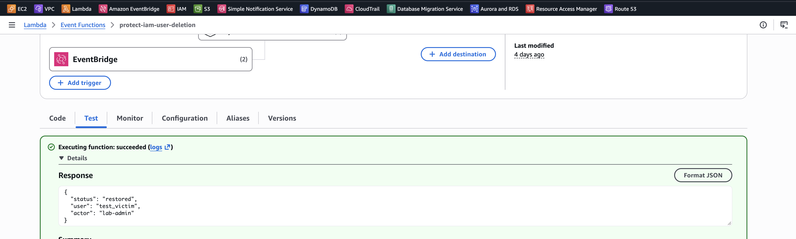
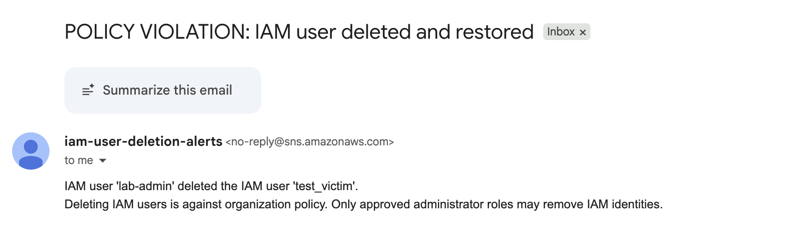
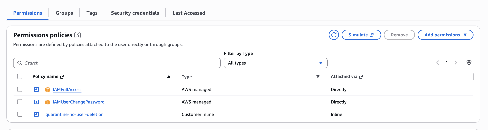
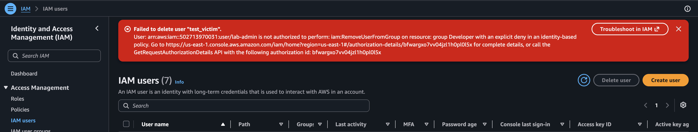

# Testing and Results

## Test Users

Two IAM users were created to validate the security automation.

| User | Purpose |
| --- | --- |
| `lab-admin` | IAM user with `IAMFullAccess`, used to perform the deletion test |
| `test_victim` | IAM user belonging to a read-only IAM group, used as the deletion target |

## Snapshot Test

The Lambda snapshot function was tested to confirm that IAM user configurations were saved in DynamoDB.

The following test event was used:

```json
{
  "action": "snapshot"
}
```

The test successfully captured **seven IAM user configurations**.



*Lambda snapshot test showing seven IAM users captured.*

## Manual DeleteUser Test

A `DeleteUser` event was submitted directly to Lambda to simulate `lab-admin` deleting `test_victim`.

The following JSON was used to test the deletion response:

```json
{
  "source": "aws.iam",
  "detail-type": "AWS API Call via CloudTrail",
  "detail": {
    "eventSource": "iam.amazonaws.com",
    "eventName": "DeleteUser",
    "userIdentity": {
      "type": "IAMUser",
      "userName": "lab-admin",
      "arn": "arn:aws:iam::000000000000:user/lab-admin"
    },
    "requestParameters": {
      "userName": "test_victim"
    }
  }
}
```

*The AWS account ID has been replaced with a placeholder.*



*Manual Lambda test event simulating an IAM user deletion.*

The Lambda function processed the event and returned:

```json
{
  "status": "restored",
  "user": "test_victim",
  "actor": "lab-admin"
}
```



*Lambda execution result reporting successful restoration.*

## SNS Email Notification

Amazon SNS was configured to send email notifications when Lambda processes an IAM user deletion event.

After the deletion and recovery process, SNS delivered an email with the subject:

**POLICY VIOLATION: IAM user deleted and restored**

The email identifies `lab-admin` as the user responsible for deleting `test_victim`.



*Email notification reporting an IAM user deletion and restoration.*

## Live IAM Deletion Test

The deletion process was also tested using the `lab-admin` IAM console.

After `test_victim` was deleted, EventBridge invoked Lambda using the matching CloudTrail event.

Lambda retrieved the saved DynamoDB snapshot, recreated `test_victim`, and attached the `quarantine-no-user-deletion` inline policy to `lab-admin`.



*Inline quarantine policy attached to the IAM user responsible for the deletion.*

A subsequent deletion attempt by `lab-admin` was denied.



*Follow-up IAM user deletion attempt denied.*

## Results

| Test | Result |
| --- | --- |
| IAM snapshot | Seven user configurations captured |
| Manual `DeleteUser` event | Lambda returned `restored` for `test_victim` |
| SNS notification | Deletion and restoration email received |
| Live IAM deletion | `test_victim` recreated from its DynamoDB snapshot |
| Quarantine | Inline deny policy attached to `lab-admin` |
| Follow-up deletion | Denied |
